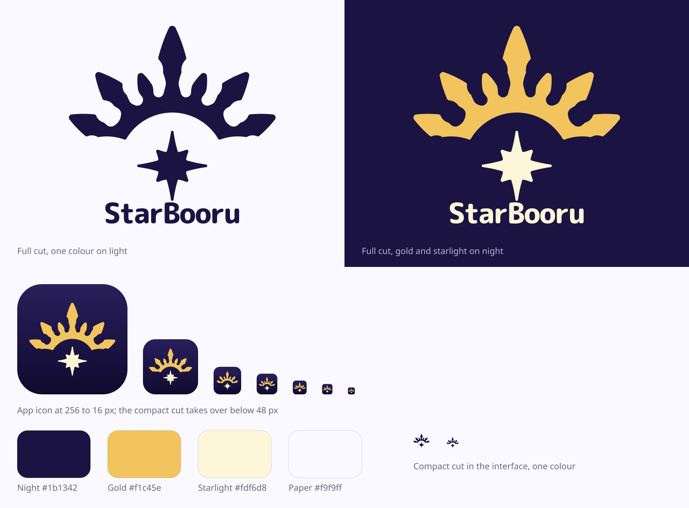

# Branding



The name is Ishtar + booru. The logo is a crown inspired by the one Ishtar wears in her second ascension in Fate/Grand Order, redrawn from scratch, with a compass star beneath the arc. An eight-pointed star is also the old symbol of Ishtar, so the star ties the name together on its own. StarBooru is an unofficial personal project, not affiliated with or endorsed by TYPE-MOON or Aniplex.

## The mark

- **Seven spears.** The centre spear is the tallest. Counting in from the outside, the first pair is slightly smaller than the second and set further apart from it. The third pair, beside the centre, is smaller and has a different shape.
- **Filled and rounded.** Every spear tip ends in a small curve, not a sharp point, and every valley is rounded.
- **Symmetrical.** Only the right half is drawn and the left is mirrored from it. The generator and a unit test both fail if the two sides ever differ.
- **The star.** A compass star with long points on the four main directions and short ones between them.

## Which cut to use

| Cut | Files | Use it for |
|---|---|---|
| Full | `docs/brand/mark.svg`, `mark-gold.svg` | 48 px and larger: sign-in page, README, app icons, print |
| Compact | `docs/brand/mark-compact.svg`, `mark-compact-gold.svg` | Below 48 px: top bars, favicons, small app icons |

The compact cut drops the barbs on the spears and is heavier, so it stays readable at 16 px. The icon generator switches between the cuts by itself.

`docs/brand/lockup.svg` and `lockup-gold.svg` set the mark beside the wordmark. `docs/brand/app-icon.svg` is the mark on the rounded night tile.

Keep a clear space around the mark of at least the width of one blade. Don't recolour single spears, add outlines or shadows, or stretch it.

## Colour

| Name | Hex | OKLCH | Role |
|---|---|---|---|
| Night | `#1b1342` | `.23 .085 285` | Icon background, the one-colour mark on light |
| Gold | `#f1c45e` | `.84 .13 85` | The crown |
| Starlight | `#fdf6d8` | `.97 .04 95` | The star, the wordmark on night |
| Paper | `#f9f9ff` | `.985 .008 285` | Light backgrounds in brand material |

These colours belong to icons and brand material only. Inside the app the mark is one colour, `currentColor`, so it follows the seed hue the user picked, like the rest of the interface. See rule 5 in `AGENTS.md`.

## Wordmark

The wordmark is "StarBooru" in M PLUS Rounded 1c ExtraBold with tight tracking, stored as outlines in `tools/brand/wordmark.json`. The rounded letters match the rounded spears. No font file is committed or needed. Always write the name as StarBooru, with both capitals.

## Where the files go

| Path | What |
|---|---|
| `apps/app/src/brand_paths.rs` | Path data for the `Mark` and `Wordmark` components in `apps/app/src/brand.rs` |
| `apps/app/assets/brand/` | Favicons, touch icon, desktop window icon |
| `apps/app/icons/` | Installer icons (`.png`, `.ico`, `.icns`), listed in `apps/app/Dioxus.toml` |
| `apps/app/android-res/` | Android adaptive icon, including the monochrome layer for themed icons, and the app name |
| `docs/brand/` | SVGs for use outside the app, and the board above |

## Changing the logo

Everything above is generated, so don't edit those files by hand. Change the numbers in `tools/brand/brand.py` and run it:

```sh
python3 -I tools/brand/brand.py
```

It needs `rsvg-convert` and ImageMagick's `magick`. `--wordmark-font <path to a .ttf>` also redraws the wordmark outlines, and that needs `fontTools`.

Then look at `docs/brand/board.png`, and rerun the brand tests, which check the symmetry and the drawing bounds:

```sh
cargo test -p starbooru-app --no-default-features --features desktop brand
```

Android needs one more step, because `dx` overwrites the icon and the app name: see `tools/brand/android-build.sh` and `docs/development.md`.
